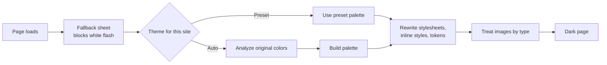

<div align="center">


# NightShift

**Comfortable, readable dark themes for every website.**
One switch, seven curated themes, remembered per site.


</div>

---

## 🌙 What is it

NightShift is a Chrome extension that turns any website into a dark theme that is easy on the eyes. It has one ON/OFF switch, seven curated themes and no sliders, and it remembers your choice for each site.

The themes are tuned for low eye strain:

- Body text is warm off-white at about 9–12:1 contrast. Pure white on black (about 20:1) causes halation on dark screens.
- Colors are capped by perceived brightness, so neon accents and vivid banners can never outshine the text.
- Images are gently dimmed, with no contrast boost.

## ✨ Features

- 🔘 **One switch**: turn NightShift on or off for every site from the popup.
- 🎨 **Seven curated themes**, including **Auto**, which adapts to each site.
- 🧠 **Remembers each site**: pick a theme once and it sticks for that site. **Make default** and **Reset** are one click away.
- ⌨️ **Keyboard shortcut**: **Alt+Shift+N** toggles NightShift everywhere (change it at `chrome://extensions/shortcuts`).
- 🖋️ **Crisp text, natural photos**: colors are rewritten one by one instead of using a blanket `invert()` filter.
- 🖼️ **Smart image handling**: dark logos get inverted so they stay visible, white diagrams become soft dark paper, photos are only gently dimmed.
- ⚡ **No white flash**: a fallback sheet covers the page from the very start until the real theme is ready.
- 🧩 **Works with modern sites**: CSS variables, Tailwind, shadcn-style tokens, CSS-in-JS, `adoptedStyleSheets` and open shadow roots.
- 🪟 **Frames match their page**: embedded widgets use the same theme as the page around them.
- ↩️ **Clean undo**: turning NightShift off removes everything it added. The page goes back to exactly what it was.

## 🎨 Themes

| Theme | Character |
| --- | --- |
| ✨ **Auto** | Learns each site: softens glare on sites that are already dark, tints surfaces with the site's brand hue, softens contrast further on reading pages, and dims photo-heavy pages less |
| **OLED Black** | True black with dimmed text; images and video dimmed more |
| **Carbon** | Warm neutral charcoal |
| **Midnight** | Deep navy blue |
| **Graphite** | Softest contrast (about 8.6:1), least glare |
| **Forest** | Calm evergreen |
| **Eclipse** | Dusky violet |

New sites use **Auto** until you choose a different default.

## 📦 Install

NightShift is not on the Chrome Web Store. Build it and load it yourself:

```bash
npm install
npm run build        # outputs dist/
```

1. Open `chrome://extensions` and turn on **Developer mode**.
2. Click **Load unpacked** and choose the `dist/` folder.
3. Pin NightShift to the toolbar and click its icon to pick a theme.

Requires Chrome 120 or newer.

## ⚙️ How it works

NightShift does not just flip the page with an `invert()` filter. It reads the page's colors and rewrites them one by one, based on what each color is used for.

- **Color mapping** ([mapper.ts](src/content/mapper.ts)): each color is mapped by its *role*:
  - Backgrounds: white becomes the theme background, and light greys become raised surfaces. A `sqrt` curve keeps the faint layering between surfaces visible.
  - Text: dark text becomes light, and colored text keeps its hue but gets lighter.
  - Borders and shadows each have their own mapping.
  - Greys pick up the theme's tint. Saturated colors such as buttons and alerts keep their hue and are darkened just enough for light text.
- **Stylesheets** ([stylesheets.ts](src/content/stylesheets.ts)): every page stylesheet gets a companion override sheet placed right after it, so the page's own cascade order still holds. This covers:
  - same-origin sheets
  - cross-origin sheets (fetched by the service worker)
  - `@import`, `@media`, `@supports`, `@layer`, `@container`, nesting and `@keyframes`
  - constructed `adoptedStyleSheets`
  - CSS-in-JS rules added via `insertRule` (caught by a small main-world hook, [hook.ts](src/content/hook.ts))
- **Design tokens** ([css-value.ts](src/content/css-value.ts)): each color custom property gets one variant per role (`--ns-bg--x`, `--ns-text--x`, …), and each `var(--x)` is rewritten to the variant for where it's used. Also handled:
  - shadcn-style HSL triplets (`hsl(var(--background))`)
  - RGB triplets
  - Tailwind's `rgb(255 255 255 / var(--tw-bg-opacity))`
  - `oklch()`
- **Inline styles and old attributes** ([inline.ts](src/content/inline.ts)): `style="…"`, `bgcolor`, `<font color>` and SVG `fill`/`stroke` are overridden per element through data attributes.
- **Shadow DOM** ([engine.ts](src/content/engine.ts)): open shadow roots, including web components and Lit-style shared sheets, get the same treatment.
- **Images** ([images.ts](src/content/images.ts)): each image is sampled on a canvas and handled by type:
  - Dark logos and icons on transparent backgrounds are inverted so they stay visible.
  - White line art (diagrams, charts) is inverted to soft dark paper.
  - Other glaring white images are dimmed.
  - Photos only get the theme's gentle brightness/contrast treatment.
- **No white flash** ([base-css.ts](src/content/base-css.ts)): a temporary fallback sheet covers the page from `document_start` until the real overrides are ready.
- **Auto** ([auto.ts](src/content/auto.ts)): Auto reads the site's *original* colors, with NightShift's sheets briefly turned off. It checks:
  - background brightness across the viewport
  - text color
  - `<meta name="theme-color">`, or the main hue of headers, buttons and links
  - how much of the first screen is media
  - how much reading content there is

  The result is cached per site, so the next visit gets the right palette right away.



## 🔐 Permissions

| Permission | Why NightShift needs it |
| --- | --- |
| `storage` | Saves the ON/OFF switch, your default theme, your per-site choices and Auto's cached analysis in `chrome.storage.local`. |
| `scripting` | Injects the theming scripts into tabs that were already open when you install or update the extension. |
| Host access `<all_urls>` | Runs the theming scripts on every site and frame, and lets the service worker re-fetch a page's cross-origin stylesheets and images, which the page itself cannot read. |

## 🛡️ Privacy

NightShift has no analytics, no tracking and no server of its own. All settings stay in your browser's local extension storage. The only network requests it makes are re-fetches of stylesheets and images the page you are viewing already uses, so it can read and recolor them.

## 🗂️ Settings model

Everything is stored in `chrome.storage.local`:

- `enabled`: the global switch.
- `defaultTheme`: used on sites you haven't chosen a theme for. It starts as `auto`; use **Make default** in the popup to change it.
- `sites`: your theme choice for each hostname. Picking a theme in the popup saves it for the current site. **Reset** removes the entry so the site follows the default again.
- `analysis`: Auto's cached analysis for each site, capped at 400 entries.

Frames use their top-level page's choice, so embedded widgets match the page around them.

## 🛠️ Development

| Command | What it does |
| --- | --- |
| `npm run build` | Builds the extension into `dist/` |
| `npm run dev` | Rebuilds on change; then click reload on the extension card |
| `npm run typecheck` | Type-checks with `tsc --noEmit` |
| `npm run icons` | Regenerates the toolbar icons in `public/icons/` |
| `npm run package` | Builds and zips `dist/` into `nightshift.zip` |

The build ([scripts/build.mjs](scripts/build.mjs)) uses Vite. The popup is a React app; `content.js`, `hook.js` and `background.js` are single-file IIFE bundles, because MV3 content scripts can't be ES modules.

## 📁 Project structure

```
public/
  manifest.json          MV3 manifest
  icons/                 toolbar icons (on and off states)
scripts/
  build.mjs              Vite builds: popup (React), content/hook/background (IIFE bundles)
  generate-icons.mjs     draws the icons
src/
  background/index.ts    service worker: cross-origin fetches, shortcut, toolbar icon state
  content/               the theming engine (entry: index.ts)
    engine.ts            applies a palette to the page and its shadow roots
    mapper.ts            maps each color by role
    stylesheets.ts       companion override sheets
    css-value.ts         CSS values and design tokens
    inline.ts            inline styles and legacy attributes
    images.ts            image sampling and treatment
    auto.ts              Auto's site analysis
    base-css.ts          no-flash fallback sheet
    hook.ts              main-world hook for CSS-in-JS
  popup/                 React popup
  shared/                color math, theme presets, storage, message types
```

## ⚠️ Limitations

- Closed shadow roots and canvas-drawn UIs (maps, some editors) can't be restyled. Canvas only gets the image dimming.
- Chrome doesn't let extensions run on `chrome://` pages, the Chrome Web Store or the built-in PDF viewer.
- Background images are only replaced when they are dark icons on transparent backgrounds. Large decorative backgrounds are left as they are.
